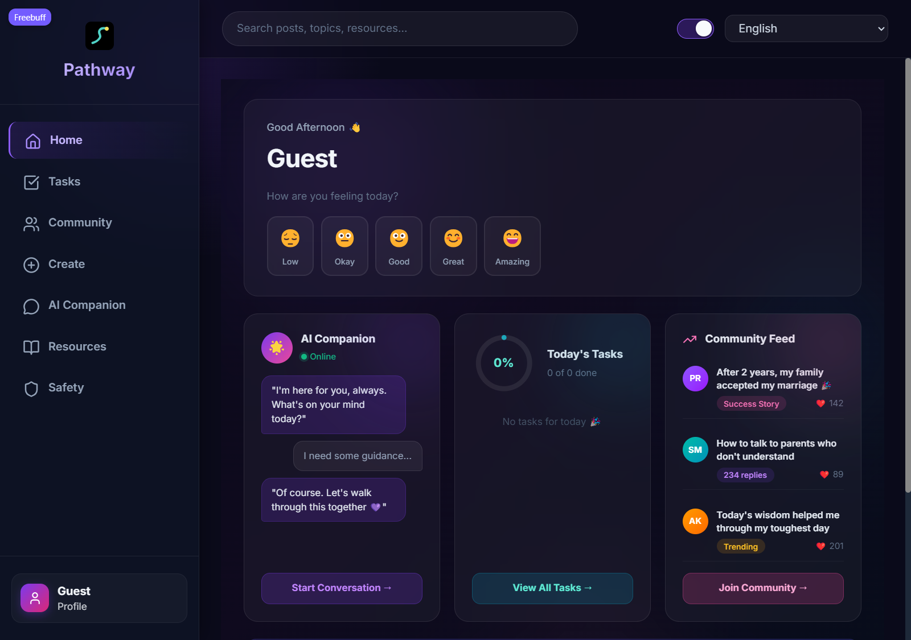
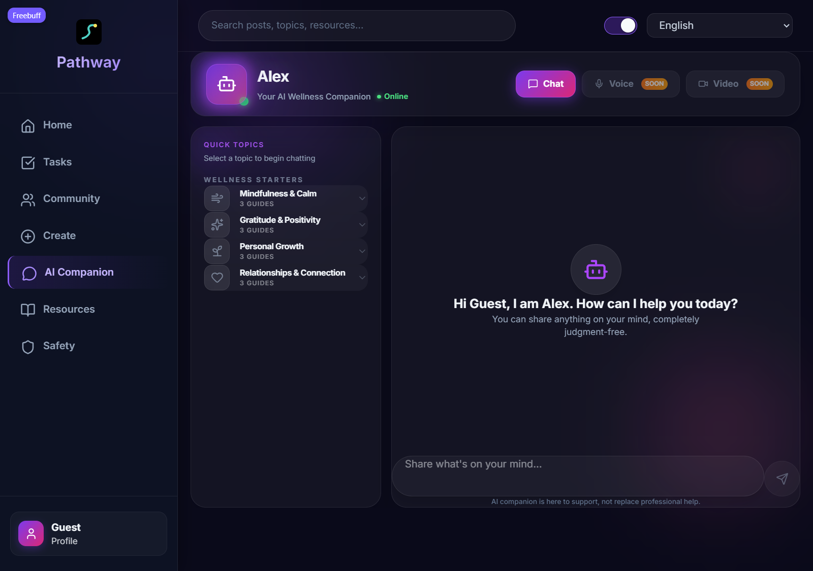
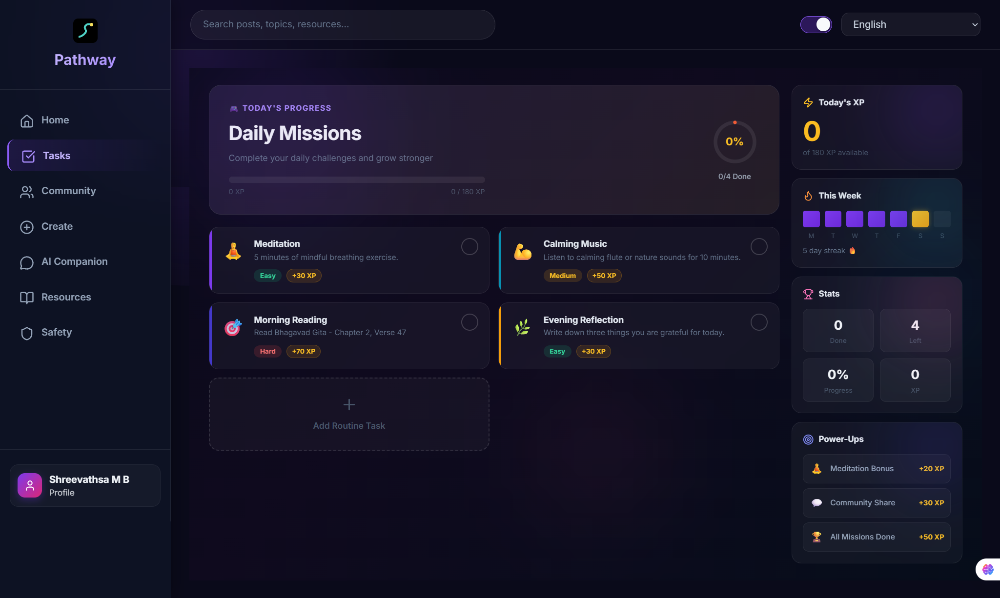
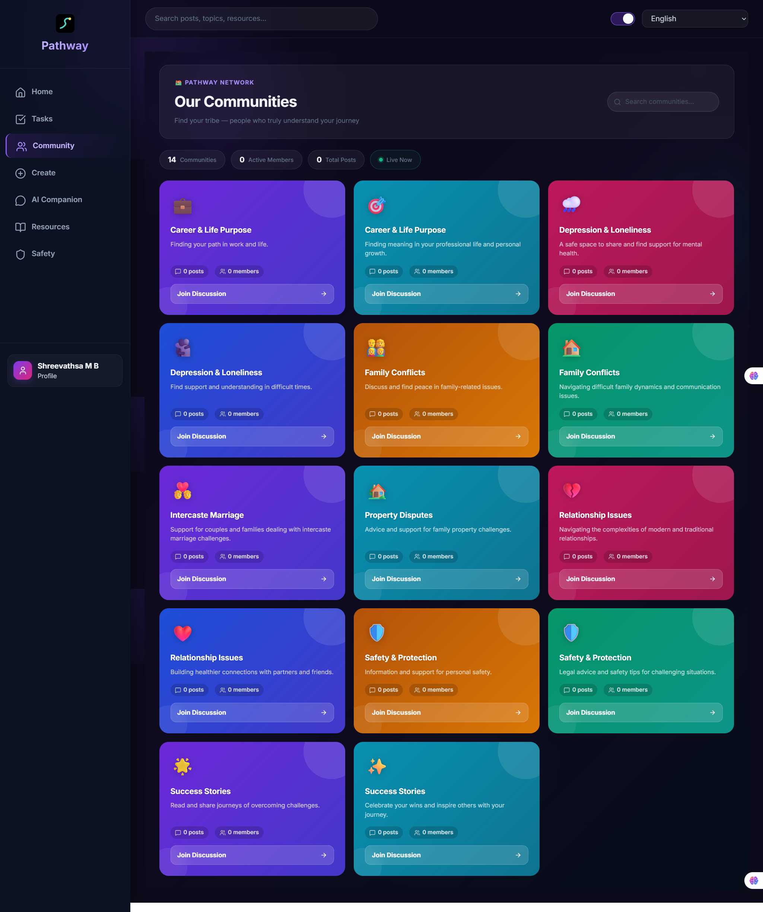
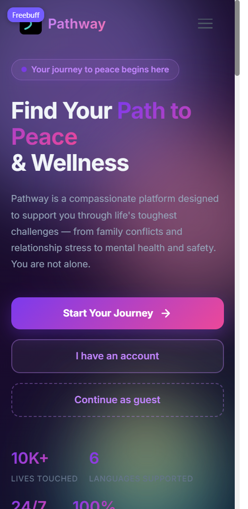

# Pathway - Mental Wellness Web Application

🛤️ **A comprehensive platform to help people find peace through daily wellness tasks, AI companionship, community support, and personalized resources.**

## 📁 Project Structure

```
pathway/
├── pathway-backend/     # Django REST API backend
│   ├── users/          # User authentication & profiles
│   ├── tasks/          # Daily tasks & streak system
│   ├── community/      # Forums & discussions
│   ├── ai_companion/   # AI chat with Claude API
│   ├── resources/      # Content library
│   ├── safety/         # Emergency contacts & legal info
│   └── README.md       # Backend documentation
│
├── pathway-frontend/    # React frontend (to be built)
│   └── README.md       # Frontend documentation
│
├── MONGODB_SETUP.md    # MongoDB installation guide
└── README.md           # This file
```

## 🌟 Key Features

- **Daily Tasks & Streaks** - Build healthy habits with daily wellness activities
- **AI Companion** - Personalized support with Claude AI in your language
- **Community Forums** - Connect with others facing similar challenges
- **Resources Library** - Curated videos, articles, music, and meditation
- **Safety Section** - Emergency contacts and legal information
- **Multi-language** - Telugu, Hindi, Tamil, Kannada, Malayalam, English

## 📸 Screenshots

| Home Dashboard | AI Companion |
|---|---|
|  |  |

| Tasks & Daily Missions | Community |
|---|---|
|  |  |

| Resources Library | Mobile Landing |
|---|---|
|  |  |

---

## 🚀 Quick Start

### Backend Setup

1. **Navigate to backend directory**
   ```bash
   cd pathway-backend
   ```

2. **Create virtual environment**
   ```bash
   python -m venv venv
   .\\venv\\Scripts\\activate  # Windows
   ```

3. **Install dependencies**
   ```bash
   pip install -r requirements.txt
   ```

4. **Configure environment**
   - Copy `.env.example` to `.env`
   - Add your NVIDIA NIM API key (get a free one at https://build.nvidia.com)
   - Configure your MongoDB connection string

5. **Run migrations**
   ```bash
   python manage.py migrate
   ```

6. **Start server**
   ```bash
   python manage.py runserver
   ```

   API available at: `http://localhost:8000/`

### Frontend Setup

```bash
cd pathway-frontend
npm install
npm run dev
```

Frontend runs at: `http://localhost:5173`

### ⚡ Run both at once (Windows)

```powershell
powershell -ExecutionPolicy Bypass -File .\dev.ps1
```

## 📋 Prerequisites

- Python 3.9+
- Node.js 18+ (for frontend)
- MongoDB (local or Atlas)
- NVIDIA NIM API key (free at https://build.nvidia.com)

## 🗄️ Database Setup

### MongoDB Options

**Option 1: MongoDB Atlas (Recommended)**
- Free cloud database
- No local installation needed
- See `MONGODB_SETUP.md` for detailed setup

**Option 2: Local MongoDB**
- Download from mongodb.com
- Install and start service
- Use connection: `mongodb://localhost:27017/pathway`

## 🤖 AI Companion

The AI companion uses the **NVIDIA NIM API**. To get a free key:
1. Visit https://build.nvidia.com
2. Sign up and generate an API key
3. Add to `.env`: `ANTHROPIC_API_KEY=your-nvidia-key`

## 📡 API Documentation

### Base URL
```
http://localhost:8000/api/
```

### Endpoints

**Authentication**
- `POST /users/register/` - Register new user
- `POST /users/login/` - Login
- `POST /users/logout/` - Logout

**Profile**
- `GET /users/profile/` - Get profile
- `PUT /users/profile/` - Update profile

**Mood & Streak**
- `POST /users/mood/` - Log mood
- `GET /users/mood/history/` - Mood history
- `POST /users/streak/update/` - Update streak

See `pathway-backend/README.md` for complete API documentation.

## 🛠️ Technology Stack

**Backend**
- Django 4.2 + Django REST Framework
- SQLite (Django auth) + MongoDB (flexible data)
- Anthropic Claude API
- JWT Authentication

**Frontend**
- React 19 + TypeScript (Vite)
- Tailwind CSS 4
- Axios
- React i18next
- React Router DOM

## 📱 Target Audience

- Indians aged 30-60
- Dealing with:
  - Depression & loneliness
  - Family conflicts
  - Relationship issues
  - Life regrets
  - Career challenges

## 🔐 Security & Privacy

- JWT token authentication
- Anonymous posting option
- Encrypted passwords
- CORS protection
- Secure file uploads

## 🌍 Languages Supported

- English (en)
- Telugu (te)
- Hindi (hi)
- Tamil (ta)
- Kannada (kn)
- Malayalam (ml)

## 📊 Current Status

### ✅ Completed
- Django project setup
- Database models (all apps)
- User authentication system
- API structure
- Admin interface

### 🚧 In Progress
- API views and serializers for all apps
- AI companion integration
- Initial data population

### ⏳ Upcoming
- React frontend development
- Multi-language translations
- Testing and deployment

## 🤝 Development

### Running Tests
```bash
cd pathway-backend
python manage.py test
```

### Creating Superuser
```bash
python manage.py createsuperuser
```

### Admin Panel
Access at: `http://localhost:8000/admin/`

## 📖 Documentation

- **Backend**: See `pathway-backend/README.md`
- **MongoDB Setup**: See `MONGODB_SETUP.md`
- **API Docs**: Available after starting server

## 🆘 Important Note

**This application is a support tool, not a replacement for professional mental health care.**

If you're in crisis:
- India: Call 1800-599-0019 (AASRA)
- Emergency: 112
- Women Helpline: 181

## 💡 Vision

To create a safe, supportive digital space where people can:
- Find daily peace through structured wellness activities
- Connect with understanding community members
- Access personalized AI support anytime
- Learn about their rights and safety
- Build lasting positive habits

---

Built with ❤️ to help people find their pathway to peace.
